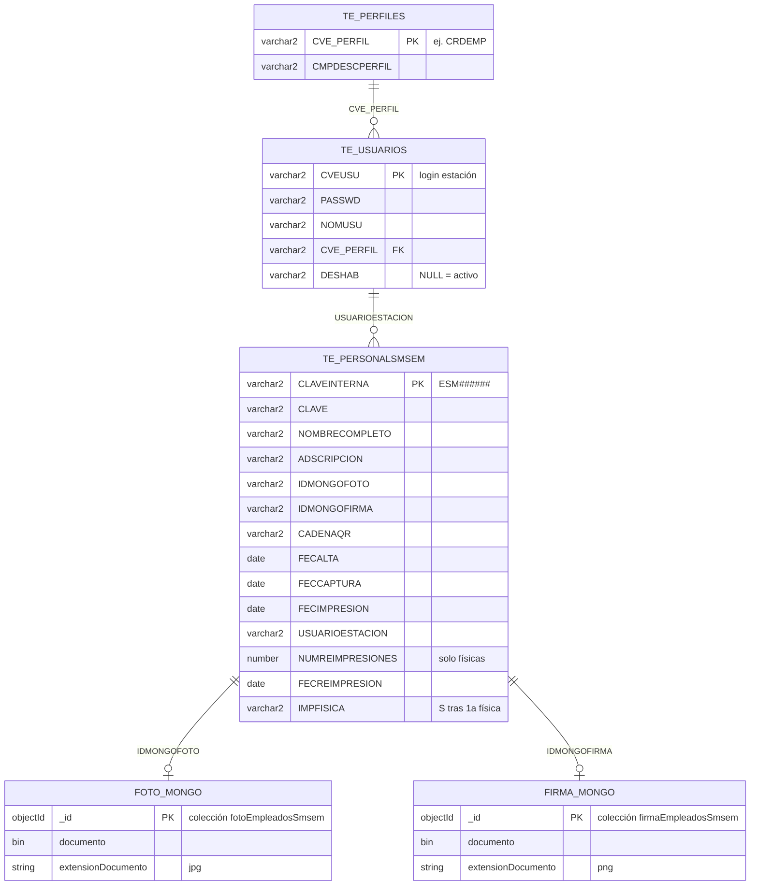

# Ejecutar CredencialesSM desde Eclipse

El error «faltan los componentes de JavaFX runtime» aparece si Eclipse lanza `CredencialesApp` directo. Esa clase extiende JavaFX. La clase que hay que ejecutar es `mx.org.smsem.credencialessm.CredencialesMain`.

## Importar

1. File → Import → Maven → Existing Maven Projects.
2. Importar estas dos carpetas:
   - `/home/ojmn/EspaciosTrabajo/Eclipse/sidid`
   - `/home/ojmn/EspaciosTrabajo/Eclipse/CredencialesSM`
3. Clic derecho en **credencialessm** → Maven → Update Project.
4. El JDK del proyecto debe ser Java 21. En esta máquina: `/home/ojmn/programas/java/amazon-corretto-21.0.12.8.1-linux-x64`.
5. En Eclipse (Window → Preferences → Java → Installed JREs) debe existir ese Corretto 21. Este Eclipse (4.24) no trae el entorno `JavaSE-21`; el launch `CredencialesSM.launch` apunta al JRE por nombre (`amazon-corretto-21.0.12.8.1-linux-x64`). Si aparece `install is null` al lanzar, es porque el run configuration sigue usando `JavaSE-21`: cámbialo a ese JRE concreto.

El script carga el padrón en `TE_PERSONALSMSEM` y el usuario `operador` / `operador123` con perfil `CRDEMP`. Las consultas, altas y el seguimiento salen de esa tabla. La fotografía se toma con la cámara y la firma con el pad Topaz (SignatureGem 1X5-HID, USB `06a8:0043`).

En Linux el nodo `/dev/hidraw*` del pad queda de root. Sin permiso de lectura y escritura la estación lo ve conectado y no lo abre. Una vez, con la contraseña:

```
/home/ojmn/EspaciosTrabajo/Eclipse/sidid/scripts/setup-topaz.sh
```

Después desconecta el pad 10 segundos y vuelve a conectarlo.

## Ejecutar

1. Abrir `CredencialesMain.java`.
2. Clic derecho → Run As → Java Application.

La dirección del servidor, el token, el modo de impresora y el resto de valores de la estación están en `src/main/resources/credencialessm/constantes.properties`. Ahí se cambian una sola vez.

`impresora.modo=preview` guarda un PNG de la credencial. En la estación Windows, con la Zebra, usar `zxp7`.

SMSEM debe estar levantado contra la base de desarrollo y la tabla `TE_PERSONALSMSEM` creada con `CredencialesSM/sql/TE_PERSONALSMSEM.sql`.

### Producción (módulo y vigencia)

En `sql/produccion/` están los scripts para alta en producción (orden en ese `README.md`):

1. DDL de `TE_PERSONALSMSEM`
2. Perfil `CRDEMP` en `TE_PERFILES`
3. Módulo `EST_CRDEMP` en `TE_MODULOS` con `FECVIG` / `FECVEN` (`ESWEB=0`, no menú web)
4. Relación en `TR_RELMOD` (`CRDEMP` ↔ `EST_CRDEMP`)
5. Operadores en `TE_USUARIOS`

El login de la estación exige perfil `CRDEMP`, fila en `TR_RELMOD` y módulo vigente. Para caducar: `sql/produccion/06_caducar_modulo.sql`.

Cada ingreso exitoso se registra en la misma bitácora de SMSEM (`TB_ACCESOS`), con `CVE_MODPADRE = EST_CRDEMP` para distinguir la estación del portal web.

## Modelo de datos (estación de escritorio)

Solo lo que usa CredencialesSM vía SMSEM. Oracle guarda padrón y operadores; Mongo guarda binarios de foto y firma. Las flechas a Mongo y `USUARIOESTACION` son lógicas (ids / login), no FK declaradas.



- Perfil de ingreso a la estación: `CRDEMP`.
- Altas de personal: secuencia Oracle `SEQ_PERSONALSMSEM` → `CLAVEINTERNA` (`ESM000486` en adelante).
- Al imprimir, SMSEM guarda foto/firma en Mongo y escribe los ObjectId en `IDMONGOFOTO` / `IDMONGOFIRMA`.

La foto y la firma se guardan en MongoDB. En esta máquina el contenedor es `smsem-mongo` (`mongo:4.4`) en el puerto `27018`, porque el `27017` ya lo usa otro proyecto (`sidi-mongo`).

### MongoDB (Docker)

Si el contenedor aún no existe, créalo una vez:

```
docker run -d --name smsem-mongo --restart unless-stopped \
  -p 27018:27017 -v smsem-mongo-data:/data/db mongo:4.4
```

Para iniciarlo cuando ya existe:

```
docker start smsem-mongo
```

Comprobar que responde:

```
docker exec smsem-mongo mongo --quiet --eval 'db.runCommand({ ping: 1 })'
```

En `/opt/documents2/properties/propertiesSMSEM.properties` la conexión debe quedar así (requiere permisos de root para editarlo):

```
servidor.SMSEM=mongodb://127.0.0.1:27018
base.SMSEM=test
```

Comando de ejemplo:

```
sudo sed -i 's|^servidor\.SMSEM=.*|servidor.SMSEM=mongodb://127.0.0.1:27018|' \
  /opt/documents2/properties/propertiesSMSEM.properties
```

## Si Eclipse sigue sin ver JavaFX

En la misma configuración de ejecución, pestaña Arguments → VM arguments, pegar (ajusta la ruta de `.m2` si no es esta):

```
--module-path /home/ojmn/.m2/repository/org/openjfx/javafx-base/21.0.2/javafx-base-21.0.2-linux.jar:/home/ojmn/.m2/repository/org/openjfx/javafx-graphics/21.0.2/javafx-graphics-21.0.2-linux.jar:/home/ojmn/.m2/repository/org/openjfx/javafx-controls/21.0.2/javafx-controls-21.0.2-linux.jar:/home/ojmn/.m2/repository/org/openjfx/javafx-swing/21.0.2/javafx-swing-21.0.2-linux.jar --add-modules javafx.controls,javafx.swing
```

En Windows el separador del `--module-path` es `;` y el sufijo de esos JAR es `-win`. La ruta sale de `%USERPROFILE%\.m2\repository\org\openjfx\`. En este Eclipse Linux el lanzador usa el JRE instalado `amazon-corretto-21.0.12.8.1-linux-x64` (no el entorno `JavaSE-21`, que aquí no existe).
